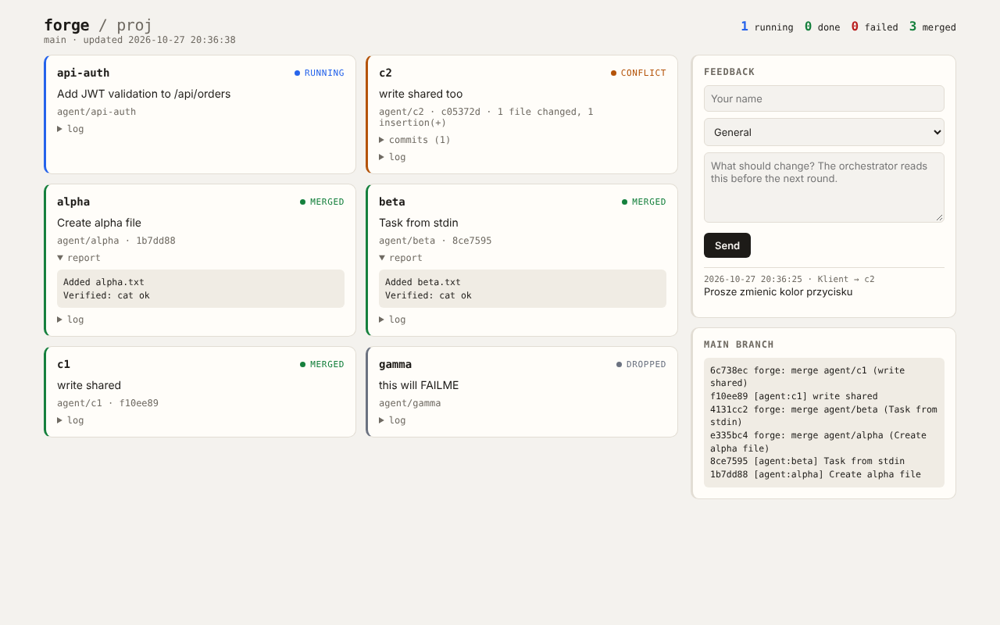

# forge — Claude Code orchestrates, Codex builds

[](https://github.com/szmajduch/agent-forge/actions/workflows/test.yml)

A set of scripts for one workflow: **tmux + git worktrees + Claude Code (orchestrator) + Codex CLI (workers)**,
with a status page you can expose through Cloudflare.

```
tmux session "forge"
├── orchestrator   Claude Code in the repo directory — plans, delegates, reviews, merges
├── dashboard      status page on 127.0.0.1:8787 (+ client feedback)
├── <worker-1..N>  Codex `exec` — each on its own agent/<name> branch and worktree
│                  (build = changes code, analysis = reads and writes a report)
└── tunnel         cloudflared → public URL for the dashboard (FORGE_TUNNEL=1)
```



## Architecture

Three things make a run reproducible: each worker is isolated in its own
worktree, the orchestrator never writes code itself, and all shared state lives
in one directory of JSON files.

### Isolation — one worker, one branch, one worktree

The main checkout is never touched by a worker. `forge-spawn` creates a branch
and a worktree for it, and the worker is started with that worktree as its
working directory, in a tmux window of its own.

```
       your repo (main checkout)                    ../.forge-wt/<repo>/
       ┌───────────────────────────┐                ┌──────────────────────┐
       │ main          ← you work  │   worktree add │ fix-login/           │
       │ .forge/       ← state     ├───────────────►│   (agent/fix-login)  │ ← worker 1
       │ .git/                     │                ├──────────────────────┤
       │                           ├───────────────►│ add-export/          │
       └───────────────────────────┘                │   (agent/add-export) │ ← worker 2
                   ▲                                └──────────────────────┘
                   │  forge-merge --no-ff (only after you review the diff)
                   └──────────────────────────────────────────┘
```

A worktree holds **tracked files only**, which is why gitignored paths need
`--link` (see [Data outside the repo](#data-outside-the-repo---link)). forge
never pushes: merging into your branch is the last step it takes, and the
remote is yours.

### The loop — who does what

```
   you                orchestrator              worker N              harness
    │                 (Claude Code)           (codex/claude/agy)     (forge-run)
    │   goal              │                         │                    │
    ├────────────────────►│                         │                    │
    │                     │  plan, split into tasks │                    │
    │   "ok"              │                         │                    │
    ├────────────────────►│                         │                    │
    │                     │   forge-spawn ─────────────────────────────► │
    │                     │                         │ ◄── brief + rules  │
    │                     │                         │                    │
    │                     │                         │ edits code,        │
    │                     │                         │ runs the           │
    │                     │                         │ acceptance check   │
    │                     │                         │ writes the report  │
    │                     │                         ├───────────────────►│
    │                     │   forge-wait            │                    │ commits
    │                     │ ◄───────────────────────────── status ───────┤ (never pushes)
    │                     │   forge-review (reads the diff)              │
    │   report            │   forge-merge --no-ff                        │
    │ ◄───────────────────┤                                              │
```

The worker never commits — the harness does, after the run, so a worker that
dies mid-task cannot leave half a commit. The orchestrator never merges without
reading the diff first, and `forge-drop` (which destroys work) has to ask you.

### Worker lifecycle

```
                        forge-spawn
                             │
                             ▼
                        ┌─────────┐
                        │ queued  │
                        └────┬────┘
                             │ forge-run starts the CLI
                             ▼
                        ┌─────────┐
            ┌───────────┤ running ├───────────┐
            │           └────┬────┘           │
   worker exited ≠ 0         │          nothing produced
   or agy auto-denied        │          (no diff / no report)
            ▼                ▼                ▼
       ┌────────┐       ┌────────┐      ┌───────────┐
       │ failed │       │  done  │      │ nochanges │
       └────────┘       └───┬────┘      └───────────┘
      worktree kept         │
      for inspection        │ forge-merge
                     ┌──────┴──────┐
                     ▼             ▼
                ┌────────┐   ┌──────────┐
                │ merged │   │ conflict │ ← merge aborted, tree left clean
                └────────┘   └──────────┘

   at any point:  forge-cancel → cancelled (branch kept, partial work committed)
                  forge-drop   → dropped   (branch and worktree deleted)

   failed/nochanges/cancelled ──forge-retry──► queued  (same branch and worktree;
                  continues from the partial work unless --fresh resets it)
```

`done` means the run finished, **not** that there is a deliverable — always
read the report.

### State — one file per worker

Everything the commands show comes from `.forge/`, which is excluded from git
automatically. `agent_set` is the only writer.

```
   forge-spawn ─┐
   forge-run  ──┤                      .forge/
   forge-merge ─┼──► agent_set ──►     ├── agents/<name>.json   status, branch,
   forge-cancel ┤   (locked, atomic)   │                        base_sha, model,
   forge-drop  ─┘                      │                        provider, commands,
                                       │                        report, commit
                                       ├── tasks/<name>.md      the brief
                                       ├── logs/<name>.log      raw CLI output
                                       ├── usage/<name>.json    agy token envelope
                                       └── feedback.jsonl       dashboard comments
                                              │
   forge-status ──┐                           │
   forge-wait   ──┤                           │
   forge-review ──┼──◄── agent_get ───────────┘
   forge-clean  ──┤
   dashboard    ──┘
```

`forge-spawn` and `forge-run` live in different tmux windows and cannot pass
anything through the environment, so the agent file is also the channel between
them: the spawn records the model, kind, effort and allowed commands, and the
run reads them back.

Writes are serialised with a lock, because `agent_set` is a read-modify-write:
`jq` reads the file and `mv` replaces it a moment later. The `mv` is atomic, so
the file is never torn, but two writers racing on the same agent would both
read the old JSON and the second would discard the first's field — a status
that appears to move backwards. The lock is a `mkdir` (atomic everywhere;
macOS has no `flock`) recording the holder's pid, and a waiter reclaims it only
once that process is gone, so a slow holder is waited for rather than robbed.

## Install (macOS) — once, not per project

The `forge` folder is a tool shared by all your projects. Keep it in one fixed
place (e.g. `~/tools/forge`) and **do not copy it into a repo**. Only the files
produced by `forge-init` belong in a project (see below).

Run the `forge-*` commands **inside your project repository**, not inside the
tool directory — otherwise forge would treat itself as the project. There is a
guard for that, with a message.

```bash
# dependencies
brew install tmux jq git python
npm i -g @anthropic-ai/claude-code @openai/codex
claude          # sign in once
codex login     # sign in once
brew install cloudflared          # optional, to expose the dashboard

# forge
mkdir -p ~/tools && unzip forge.zip -d ~/tools   # → ~/tools/forge
~/tools/forge/install.sh   # installs the forge-* commands into ~/.local/bin and checks dependencies
```

Run `install.sh` again whenever you **move** the forge folder, and whenever you
**pull a new version**: the launchers are created one per file in `bin/`, so a
command added since your last install is not on your PATH and fails with
`command not found` — including mid-run, when `FORGE.md` tells the
orchestrator to use it. `forge-doctor` reports exactly which ones are
missing.

`install.sh` does not change environment variables or shell configuration
files. If `~/.local/bin` is not on your `PATH` (on macOS it is not by default),
it prints the line to add yourself:

```bash
echo 'export PATH="$HOME/.local/bin:$PATH"' >> ~/.zshrc && source ~/.zshrc
```

Optionally [lemux](https://github.com/Photon48/lemux) — forks orchestrator
conversations into separate tmux windows. It works alongside forge with no
configuration.

## Getting started in a project

Every `forge-*` command is a script from this kit's `bin/` directory, not an
external tool. `./install.sh` creates short launchers for them in
`~/.local/bin`, so they work from any directory.

```bash
cd ~/code/my-project
forge-init                       # PROJECT.md, CLAUDE.md, AGENTS.md, FORGE.md, .claude/settings.json
git add -A && git commit -m "forge setup"   # important: workers start from a commit and must see AGENTS.md
forge-doctor                     # checks everything is ready (dependencies, role files, models)
forge-up                         # opens the tmux session with Claude Code in window 0
```

In Claude Code, just describe the goal, e.g.:

> Add a /api/orders/export endpoint (CSV), tests and a button in the UI. Split it across workers.

Claude will write a plan, start workers once you say "ok", wait, review the
diffs and merge. Move between tmux windows with `Ctrl-b w` (list) or
`Ctrl-b <number>`.

**The mouse is off in the session** and that is deliberate — with `mouse on`
the wheel stops scrolling the Claude Code window and drops it into tmux's
copy-mode instead. Details and how to turn it back on: see
[Scrolling and the mouse](#scrolling-and-the-mouse).

## Two kinds of task: build and analysis

A Codex worker does not have to change code — it can also **analyse**. Same
agent, different contract for the result:

| Kind | `--kind` | Result | Done when |
|---|---|---|---|
| **build** | `build` (default) | changed code | the acceptance check passes |
| **analysis** | `analysis` | a report | the report answers the question with evidence |

```bash
forge-spawn --kind analysis cusip-audit "Check CUSIP→CIK coverage in .work/..."
```

Use `analysis` when the task is to **establish** something rather than change
it: auditing data, verifying another worker's result, investigating a bug
before fixing it, reviewing an implementation. Do not force such a task into a
build brief — there is no test to pass there, and a worker told to change code
will change the code it was only supposed to read.

**The report is the deliverable, not a note.** The worker writes it to
`reports/<name>.md` and the harness **commits it together with the work** — it
is never deleted or truncated. Only a preview of the first 4 KB, with a pointer
to the full text, lands in `.forge/agents/<name>.json` (and therefore in
`forge-status`, `forge-review` and the dashboard). The older `FORGE_REPORT.md`
in the root still works — the harness moves it to `reports/<name>.md`.

For analysis tasks `AGENTS.md` requires explicitly: a source for every claim
(path, line, hash), observation kept separate from inference, and that
**"unresolved" is a correct answer** — better than a guess.

### Independent verification

To have a worker check another's work **independently**, give it a base from
before that work rather than the other's branch — otherwise it inherits the
reasoning it is meant to check:

```bash
forge-spawn --kind analysis verify --base main "Check the report from agent/audit..."
```

`--base <ref>` works like `FORGE_BASE` but per worker. Flags may be given
before or after the name.

### Data outside the repo (`--link`)

A worktree contains **only files tracked by git**, so anything in
`.gitignore` (a virtualenv, large data) does not exist inside it. Link it
explicitly:

```bash
forge-spawn --kind analysis audit --link .venv --link .work "Check ..."
```

`--link` creates a symlink from the main repo into the worktree and adds the
path to the local `info/exclude` — patterns like `.venv/` with a trailing slash
**do not match symlinks**, so without this they would show up as untracked and
a worker could commit them. You can also set `FORGE_LINK=".venv .work"`.

The `-s workspace-write` sandbox **allows reading** linked directories but
**blocks writing** outside the worktree — measured: `mkdir` in a linked `.work`
returns `Operation not permitted`. So write artifacts into the worktree and
move them to their destination after review. Do not use `--add-dir` for a
read-only directory: that would grant write access where nothing may be
modified.

## Choosing models and providers

A worker can run on three CLIs: **codex** (OpenAI), **claude** (Anthropic) and
**antigravity** (`agy`, Google). One list in `~/tools/forge/models.conf` says
which model belongs to which provider and which role it suits:

```
<name>         <provider>  <role>        <when to use it>

gpt-6.1-sol    codex       both          everyday coding and analysis
opus           claude      both          reviews, conflicting evidence, architecture
haiku          claude      worker        mechanical edits, extraction
agy-sonnet     antigravity worker        Sonnet on Google credits
default gpt-6.1-sol

slug agy-sonnet  claude-sonnet-4-6
```

- **provider**: `codex` \| `claude` \| `antigravity` — decides which CLI is run
  and how its arguments are built.
- **`slug`**: for `antigravity` only. Maps the forge name to the name
  `agy --model` accepts. It is needed because the same model is reachable two
  ways (`agy-sonnet` vs `sonnet`), so the name alone does not say which CLI to
  run. Re-check with `agy models` after a CLI update.
- **role**: `worker` \| `orchestrator` \| `both`. `forge-spawn` refuses a model
  marked `orchestrator` rather than starting a worker that cannot do the work.
- The description after the role is the hint Claude uses to pick a model — make
  it concrete.
- `default` — the model for tasks spawned without `--model`.
- A name outside the list is rejected, so Claude cannot invent a model that
  does not exist.
- The model and provider are visible in `forge-status`, in the worker log and
  on the dashboard.
- A different file for one project: `FORGE_MODELS_FILE=/path/models.conf forge-up`.
- `forge-models` also shows which CLIs you **do not have installed** — their
  models cannot be spawned.

The old two-column `models.conf` (`<name> <description>`) still works: such a
row is read as `codex` + `worker`.

### Who the orchestrator is

The orchestrator is Claude Code — it reads `FORGE.md` and delegates the work.
You choose the model:

```bash
FORGE_ORCH_MODEL=opus forge-up      # only a models.conf model with role both/orchestrator
FORGE_ORCH_CMD="claude --model opus" forge-up   # full control over the command
```

`FORGE_ORCH_MODEL` is validated: a model outside the list, one with role
`worker`, or a non-Claude model is rejected at startup rather than mid-run.

### Antigravity (`agy`) — the provider that replaced Gemini CLI

The `gemini` provider was **removed on 2026-10-30**. Google stopped serving
Gemini CLI to personal accounts — signing in still works, and then every call
fails with:

```
IneligibleTierError: This client is no longer supported for Gemini Code Assist
for individuals.  →  https://antigravity.google
```

Antigravity is the path Google redirected those accounts to, and it **works**
on a personal account (verified 2026-10-30 against `agy` 1.4.11: headless
`agy -p` runs, edits files and reports token usage). One CLI reaches three
model families:

```
$ agy models
gemini-3.8-flash-high/medium/low    Gemini 3.8 Flash
claude-sonnet-4-6                   Claude Sonnet 4.6 (Thinking)
claude-opus-4-6-thinking            Claude Opus 4.6 (Thinking)
gpt-oss-120b-medium                 GPT-OSS 120B
```

**Note what this means for billing:** `agy-sonnet` and `agy-opus` are the same
models as `sonnet` and `opus` under the `claude` provider, but they run on
Google's credits rather than your Claude subscription. Use them to spare the
Claude quota, not to get a different answer.

#### `commands.conf` — which shell commands an `agy` worker may run

In headless mode `agy` **auto-denies** every tool it would have to prompt for —
and **still exits with `status: SUCCESS` and code 0**. A worker that was never
allowed to act then looks exactly like a worker that decided there was nothing
to do.

forge handles that in two ways:

1. It passes an explicit permission list (`write_file(*)`, `replace(*)`,
   `read_file(*)` and the other reads) through `--settings`, which is
   **session-only** — your `~/.gemini/antigravity-cli/settings.json` is never
   modified.
2. It treats a non-empty `denied_actions` as a **worker failure** (`failed`),
   not `done`. Otherwise forge would report success for a worker that did
   nothing.

**Why this concerns `agy` only.** The other two providers get a *spatial*
boundary and need no list at all:

| Provider | What it gets | Permission model |
|---|---|---|
| `codex` | `-s workspace-write` | kernel sandbox: everything in the worktree, nothing outside it |
| `claude` | `--permission-mode acceptEdits` | one mode, same effect |
| `antigravity` | `--settings '{"permissions":{"allow":[…]}}'` | a **list of names** of actions and programs |

`agy` has no equivalent of `workspace-write` — a list of names is its only
mechanism. That is why this one provider needs configuration and the other two
do not.

**Two levels.** An `agy` worker always gets files; the shell it does not:

- **`commands.conf`** is the **upper bound**, your decision. One command per
  line or several separated by spaces; `#` comments are ignored.
- **`forge-spawn --commands "pytest git"`** lets the orchestrator pick a
  **subset** for one worker, matched to the acceptance check in its brief. A
  spawn without `--commands` grants the whole bound.

```
   commands.conf                    the operator's bound — your decision
   ┌───────────────────────────────────────────────────┐
   │  cd echo ls cat find grep head tail wc git        │
   │  python3 pytest                                   │
   └───────────────────────────────────────────────────┘
                │                            │
                │ forge-spawn                │ forge-spawn
                │  --commands "cd echo pytest"│  (no --commands)
                ▼                            ▼
        ┌───────────────┐            ┌──────────────────┐
        │ worker A      │            │ worker B         │
        │ cd echo pytest│            │ the whole bound  │
        └───────────────┘            └──────────────────┘

        forge-spawn --commands "curl ..."  ──►  spawn ABORTS
        curl is outside the bound; widening it is the operator's call
```

The orchestrator can **never exceed** `commands.conf`: asking for a command
outside the bound aborts the spawn with a message, before the worktree is even
created. That is deliberate — the orchestrator reads task briefs, so a brief
can convince it that `curl` is needed. Widening the bound stays your decision,
taken once in the file.

A rule names a **program**, not a pattern, and there is no globbing (verified
against `agy` 1.4.11):

| Rule | `pytest test.py` | `curl ...` |
|---|---|---|
| `command(pytest)` | ✅ | ❌ |
| `command(pytest*)` | ❌ | ❌ |
| `command(*)` | ✅ | ✅ |

**Every program in a compound command needs its own rule.** This is the trap
worth knowing, because the denial message does not reveal it. `agy` does not
run a bare `pytest test_t.py`; it builds:

```
cd /path/to/worktree && pytest test_t.py; echo "EXIT_STATUS: $?"
```

which needs `cd`, `pytest` **and** `echo`. Allowing only `pytest` denies the
whole command, and `denied_actions` reports just `"command"` — never which part
was missing. `cd` and `echo` are therefore in the default `commands.conf`;
without them almost every acceptance check fails, however the task is worded.

**Narrowing has a floor.** An `agy` worker orients itself before acting, so a
subset must keep `cd echo ls cat` alongside the check's own programs. Measured:
`--commands "cd echo pytest"` was denied in the worker's **first** turn, before
it read anything, while the same task with the whole bound passed and committed
the fix. If you are not sure the floor is covered, omit `--commands`.

`forge-doctor` prints the current bound and warns when it is empty.

**A warning about `*`.** `agy` has no sandbox, so `*` does **not** mean "any
command in the worktree" — it means any command anywhere, including `curl` and
`rm -rf` on paths outside the repo. The worktree is only the working directory
(`tmux new-window -c`), not a boundary. With codex the boundary is enforced by
the kernel sandbox; with `agy` it would be a convention and nothing more. By
writing `*` you choose to rely on the model's judgement instead of an enforced
limit.

`FORGE_AGY_COMMANDS` still works and **replaces** the whole file — an escape
hatch for a one-off experiment, following forge's convention that the
environment beats configuration.

#### Reasoning effort is part of the model name

For `agy` models the reasoning level is part of the slug
(`-high`/`-medium`/`-low`), and passing `--effort` as well is a hard error
(`--model X conflicts with --effort=Y`). forge **drops** `--effort` for these
models and prints a note instead of failing the spawn.

**The model list changes.** It is refreshed from the server, so `models.conf`
can go stale. How to check what your CLI accepts:

```bash
# what the account has available (server list, the cache can be stale)
python3 -c "import json,re;s=open('$HOME/.codex/.codex-global-state.json').read();\
print(json.loads(re.search(r'"eligible_codex_model_slugs":\s*(\[[^]]*\])',s).group(1)))"

# what was actually used
grep -rho '"model":"[^"]*"' ~/.codex/sessions --include='*.jsonl' | sort | uniq -c | sort -rn

# the decisive test (inside a git repo); a wrong name → model_not_found
codex exec -s read-only -m <name> "Reply with exactly: OK" < /dev/null
```

Only the third is proof — the cached list and the session history can both be
incomplete or out of date. For claude and antigravity the equivalent is
`forge-doctor --spawn`, which calls each CLI once with the flags forge actually
uses.

## Reasoning effort

`--effort low|medium|high|xhigh|max|ultra` sets how much reasoning a worker
spends. Higher means more time and more tokens; it is **not a guarantee of
correctness** and does not replace sources, tests or marking cases as
unresolved. Omitted, the model uses its own default.

```bash
forge-spawn --model gpt-6-astra --effort xhigh --kind analysis audit "Check ..."
```

| Effort | When |
|---|---|
| `low` | data extraction, a small edit, one unambiguous step |
| `medium` | the default starting point for ordinary coding and analysis |
| `high` | hard bugs, designing a solution, reasoning across several sources |
| `xhigh` | complex audits, conflicting evidence, many dependencies |
| `max` | exceptionally hard cases, where the extra time is justified |
| `ultra` | available, but with no documented advantage over `max` |

Technically: `codex exec` has **no** effort flag — forge passes it as
`-c model_reasoning_effort="<level>"`. The key `reasoning_effort` (without the
`model_` prefix) is silently ignored with an unrecognised-setting warning, so
do not write it from memory. Verified 2026-10-28 against codex-cli 0.163.0: all
six levels are accepted and a name outside the list is rejected.

## Commands

| Command | What it does |
|---|---|
| `forge-spawn [--model <m>] [--effort <level>] [--kind build\|analysis] [--base <ref>] [--link <path>] [--commands "<progs>"] <name> "<task>"` | branch `agent/<name>` + worktree + a worker in a new tmux window. The task may also come on stdin. `--model` only from `models.conf`. `--effort` = reasoning effort. `--kind analysis` = the worker writes a report instead of changing code. `--base` = a different starting point. `--link` = link a gitignored path. `--commands` = the subset of shell commands for this worker (`antigravity` only; must fit inside `commands.conf`). |
| `forge-models [--workers]` | lists models with provider and role; `--workers` hides orchestrator-only models |
| `forge-usage [--json] [--all] [--since <days>]` | token usage per provider and model + context held per session |
| `forge-plan [--json] [--provider <name>]` | how much of each provider's plan is **left**, and when each window resets |
| `forge-wait [names…] [--timeout s]` | waits for workers to finish, then shows status |
| `forge-status [--json] [name]` | table of workers; with a name — the report and the last log lines |
| `forge-review <name> [--stat]` | the worker's report, commits and diff against its starting point |
| `forge-merge <name> [--keep]` | `merge --no-ff` into the current branch; on conflict it aborts and marks `conflict` |
| `forge-cancel <name>` | stops a worker but **keeps** the branch and commits what it already did |
| `forge-retry <name> [--fresh]` | runs a finished worker again on its own branch: by default **continues** from the partial work, `--fresh` resets to `base_sha` first |
| `forge-drop <name>` | **discards** a worker's work (window, worktree, branch) — Claude must ask first |
| `forge-clean [--merged\|--dropped\|--finished\|--all] [--yes] [--dry-run]` | cleans up after finished workers: state files, worktrees, branches |
| `forge-doctor [--spawn]` | checks everything is ready before you delegate the first task |
| `forge-up [-d]` | starts the whole session |
| `forge-init` | installs the role files into the repo |
| `test/forge-test [filter]` | end-to-end tests of the whole kit (fake `codex`, nothing calls a model) |
| `test/forge-dashboard-test [filter]` | the dashboard's HTTP endpoints; also run by `forge-test` |

Worker statuses: `queued → running → done | nochanges | failed`, then
`merged | conflict | cancelled | dropped`.
`nochanges` means the worker contributed nothing — for build, no code changes;
for analysis, no report. An analysis worker that wrote a report finishes as
`done`. State lives in `.forge/` (excluded from git automatically through
`.git/info/exclude`), worktrees in `../.forge-wt/<repo>/<name>`.

## Roles — three files

`forge-init` installs a layout in which **no tool reads another's role**:

```
          ┌──────────────────────────────────────────┐
          │ PROJECT.md   project rules — the ONLY    │
          │              source of truth. YOU own it.│
          └──────────────────────────────────────────┘
                 ▲                          ▲
                 │ @PROJECT.md              │ @PROJECT.md
                 │                          │
      ┌──────────┴─────────┐     ┌──────────┴──────────────┐
      │ CLAUDE.md          │     │ AGENTS.md               │
      │ read by Claude Code│     │ read by the worker CLI  │
      │ (the orchestrator) │     │ + worker rules          │
      └──────────┬─────────┘     └─────────────────────────┘
                 │ @FORGE.md
                 ▼
      ┌────────────────────┐
      │ FORGE.md           │  the orchestrator loop.
      │ forge owns it      │  forge-init rewrites it every run —
      └────────────────────┘  put your own rules in PROJECT.md

  An arrow means "imports". Neither role file imports the other, so the
  orchestrator never inherits worker rules and no worker reads the loop.
```

- **`PROJECT.md`** — shared rules: environment, quality gate, conventions,
  traps. **This is where you write project rules.** `forge-init` creates it as
  a stub to fill in and **never overwrites** an existing one.
- **`CLAUDE.md`** — the orchestrator role; imports `@PROJECT.md` + `@FORGE.md`.
- **`AGENTS.md`** — the Codex worker role; imports `@PROJECT.md` and adds the
  worker rules: own scope only, no commits (the harness does that), report to
  `reports/<name>.md`. Separate rules for build (the acceptance check) and
  analysis (evidence for every claim, "unresolved" allowed).
- **`FORGE.md`** — the orchestrator loop: plan → spawn → wait → review → merge
  → report. Prohibitions: pushing, rewriting history, merging without reading
  the diff, `forge-drop` without asking. **forge owns this file** —
  `forge-init` refreshes it on every run, so do not add your own rules here.
- **`.claude/settings.json`** — forge-* commands allowed without prompting;
  `forge-drop`, `git push/reset/rebase` need confirmation; `.env`, `secrets/`,
  `*.pem`, `*.key` are blocked from being read.

Adapt it to the project: in `PROJECT.md` describe how to run the tests
(`./gradlew test`, `npm test`, `pytest`) and what the acceptance check is.

`forge-init` is **safe to run repeatedly**. It overwrites only `FORGE.md`;
other files it creates when missing, or adds a missing import to. If it detects
the old single-file layout (`CLAUDE.md` as a symlink to `AGENTS.md`, or
`@FORGE.md` inside `AGENTS.md`), it **does not change it** — it prints a
warning, because that is the operator's call.

## Before you delegate the first task

Four failures out of five runs in the 2026-10-28 session would have surfaced
from a single trial spawn. Hence `forge-doctor` — one command instead of a list
of manual checks:

```bash
forge-doctor            # dependencies, role files, whether they are committed, models, line endings
forge-doctor --spawn    # plus one real codex call (a few seconds)
```

Exit codes: `0` all good, `2` warnings only, `1` something is broken.
Two warnings are worth attention, because nothing else reveals them until a
worker dies:

- **"invisible to workers"** — the role files are not committed. A worker
  starts from a commit, so an uncommitted `AGENTS.md` does not exist for it.
- **"PROJECT.md is still the unfilled stub"** — there is no acceptance check
  defined, so every build worker will invent its own.

What `forge-doctor` catches besides that: missing dependencies, launchers in
`~/.local/bin` pointing at a moved forge directory, `CLAUDE.md` as a symlink to
`AGENTS.md` (both tools then get the other's role), `@FORGE.md` inside
`AGENTS.md`, a `default` in `models.conf` that is not in the model list, and
`core.autocrlf`, which breaks tests for workers only.

- **`error: unexpected argument '--full-auto'`** — you have Codex CLI ≥ 0.163.0,
  where that flag is gone. forge's default is now `-s workspace-write`; if you
  see this error, your forge copy is old.
- **A variable before `forge-spawn` has no effect?** `tmux new-window` inherits
  the **tmux server's** environment, not your shell's. `forge-spawn` passes
  `FORGE_*` explicitly through `-e` today, but for other variables use
  `tmux set-environment -t forge NAME value`.
- **A worker cannot find `.venv` / your data?** It is not in git, so it is not
  in the worktree. Use `--link` (section above) **before** spawning.
- **`forge-models: command not found`** — the launchers in `~/.local/bin` are
  stale; run `./install.sh` again.
- **Tests comparing file hashes fail for workers only?** That is line endings.
  With `core.autocrlf=true|input` git normalises CRLF on commit: your main
  checkout keeps the original bytes and the tests pass, while the worker gets
  the normalised version from git. `forge-init` warns about this setup. The fix
  is `-text` in `.gitattributes` for those paths **and** a rewrite
  (`git add --renormalize -- <path>/`) — the attribute alone will not restore
  bytes already dropped from existing blobs. Verify in a fresh worktree.

**Status `done` does not mean there is a deliverable.** A worker can finish
with a commit whose only content is a report saying "nothing could be
measured". Always read the report, not just the status.

## Stopping and cleaning up

**`forge-cancel` vs `forge-drop`.** Both stop a worker; they differ in what
survives:

| | worker | branch and worktree | what it already did |
|---|---|---|---|
| `forge-cancel <name>` | stopped | **kept** | **committed** as `[agent:<name>] cancelled: partial work` |
| `forge-drop <name>` | stopped | deleted | gone irreversibly |

`forge-cancel` is for "it is going the wrong way / it is stuck / the task
changed, but I want to see what it did". A `cancelled` status can still be
merged (`forge-merge` warns that the acceptance check never passed) or dropped
later with `forge-drop`.

**`forge-retry`** runs a worker again on its own branch, and by default
**continues** rather than restarts:

```bash
forge-retry <name>            # keep the partial work, tell the worker to carry on
forge-retry <name> --fresh    # reset the worktree to base_sha first
```

This works because a `failed` worker keeps its worktree deliberately — nothing
cleans up after it — so the half-finished work, the branch, the brief and the
model choice are all still there. The default appends a section to the brief
that states this is attempt *N*, carries the previous exit code, the files the
last attempt left uncommitted, and the tail of its log. A model that already
wrote half the change then finishes it instead of paying to redo it.

The note is rebuilt from the original brief each time (kept as
`.forge/tasks/<name>.md.orig`), so three retries do not bury the task under
three stacked notes.

`--fresh` is for when the partial state is the problem rather than the starting
point: it resets the worktree to the agent's `base_sha` and uses the original
brief unchanged. Earlier attempts stay reachable on the branch.

Retry applies to `failed`, `nochanges` and `cancelled`. A `running` worker is
refused — restarting one underneath itself would put two processes in one
worktree — so cancel it first, deliberately.

**`forge-clean`** cleans up after finished workers — state files in `.forge/`
plus the worktrees and branches of those that kept them. A worker with status
`failed` keeps its worktree **deliberately**, for inspection, and nothing else
removes it.

```bash
forge-clean                       # merged only — safe, and the default scope
forge-clean --dry-run             # show what would go, change nothing
forge-clean --dropped             # + dropped
forge-clean --finished            # + done/nochanges/failed — THIS IS UNMERGED WORK
forge-clean --all                 # + queued/running (stops them first)
```

Any scope wider than `--merged` can delete work that exists nowhere else, so it
asks for confirmation — you have to type the word `delete`. `--yes` skips the
prompt (for scripts).

**Parallel worker limit.** `forge-spawn` refuses to start when
`FORGE_MAX_WORKERS` (default 4) are already running:

```
forge: 4 worker(s) already active (limit 4): a b c d
```

This is a limit in code, not a request in a prompt — each worker is a model
plus its acceptance check, so uncontrolled fan-out can take the machine down.
Raise it with `FORGE_MAX_WORKERS=6`, or bypass it once with `--force`.
`FORGE_MAX_WORKERS=0` disables the limit.

## How much plan is left

```bash
forge-plan                   # every provider: how much quota REMAINS
forge-plan --provider claude # one provider only
forge-plan --json            # for scripts
```

```
PLAN — how much is LEFT
  claude (subscription)
    session                        #######...  70.0% left  Oct 31 at 3:09pm
    week                           ########..  78.0% left  Nov 5 at 5:59am
  codex (plus)  — from its last session, 11h ago
    5h                             ##########  99.0% left  reset since
    week                           ######....  59.0% left  in 4d 4h
  antigravity (antigravity)
    Gemini Models week             ########## 100.0% left  in 6d 6h
    Claude and GPT models week     ########..  77.0% left  in 6d 6h
```

This answers "how much do I have left", which is a different question from
"what did I spend" — see **Token usage** below for the latter. Each provider
is asked differently, and the differences matter:

| | source | costs | leaves a file |
|---|---|---|---|
| `codex` | its own session logs, already on disk | nothing, no process started | — |
| `claude` | `claude -p "/usage"` | measured: `num_turns` 0, `total_cost_usd` 0, `duration_api_ms` 0 — handled locally, never reaches the model, so asking does not consume what it reports | one transcript, which forge deletes |
| `agy` | `agy -p "/usage"` | same: 0 turns, 0 tokens | nothing at all |

Three details worth knowing:

- **codex is not read live.** Its figures are whatever the CLI last wrote, so
  the heading says how old they are, and a window whose reset time has already
  passed is marked `reset since` rather than presented as current.
- **antigravity's pools are separate from your Claude subscription.** Its
  "Claude and GPT models" quota is antigravity's own: the same model reached
  through `opus` and through `agy-opus` draws on two different plans. They are
  shown as separate rows and never summed.
- **The percentages are whole numbers**, because that is all the providers
  report. There is no finer field to read.

`FORGE_NO_PLAN=1` disables every reading, and `FORGE_DASH_PLAN=0` hides the
tile without affecting the command. The test suite sets `FORGE_NO_PLAN=1`: a
suite must not touch the operator's account.

### What one worker cost

`forge-run` reads its own provider's quota before and after the work and puts
the difference in the worker's log:

```
=== plan used by this worker ===
    session                       70.0% ->  64.0% left   -6.0 points
    week                          78.0% ->  78.0% left   <1% (below what the provider reports)
```

Only that worker's provider is asked, the "before" reading is backgrounded so
it cannot delay the start, and the reading runs from `.forge/` rather than the
worktree — `claude -p` writes its transcript next to the current directory,
and `forge-run` commits with `git add -A`, so reading from the worktree would
have committed a transcript into the worker's own commit.

Two cases are stated rather than rounded away, because rounding either one
would be a falsehood:

- a window that did not move says `<1%`, never `0%` — a short worker genuinely
  costs less than the provider reports, but it is not free;
- a window that **refilled** mid-run says `window reset mid-run — cost not
  measurable`, because part of the cost was charged to a window that no longer
  exists.

Deltas overlap when workers run in parallel: with three workers at once, each
one's figure includes the other two. The number is the plan's movement during
that worker, not that worker's isolated cost.

## Token usage

```bash
forge-usage                  # this project: per model, plus context held per session
forge-usage --all            # all local sessions, not just this repo
forge-usage --since 7        # the last 7 days only
forge-usage --json           # for scripts
```

Nothing calls an API and no key is needed — only the local session logs each
CLI writes anyway are read. The same data appears on the dashboard in the
**Tokens** tile, with remaining quota in **Plan left**.

`CONTEXT HELD` is how full a session's context window is, which is what
decides when it must compact. It used to sit beside a `PLAN QUOTA` column,
which was wrong and has been removed: plan quota is one account-wide pool, so
printing it per session showed the same pool as `1.0% used` next to
`67.0% used` — those were readings of different ages, not different
allowances, and the lower, older, more reassuring one was the wrong answer.
Remaining quota now comes from `forge-plan`, which takes the newest reading.

**Data quality differs per provider**, and that is not forge's decision but
what the providers record at all:

| Provider | Source | Tokens | Plan quota |
|---|---|---|---|
| codex | `~/.codex/sessions/**/rollout-*.jsonl` | complete, cumulative per session | **yes** — `rate_limits.used_percent` |
| claude | `~/.claude/projects/<repo>/<session>.jsonl` | complete, summed per message | no — context only |
| antigravity | `.forge/usage/<worker>.json` (written by forge) | complete, from the `usage` envelope | no |

So **only codex** shows a real percentage of the plan burned. For the others
the `PLAN QUOTA` column is `n/a` — forge does not guess, and does not convert
any of it into money, because it does not know your plan's prices.

The `CONTEXT USED` column is `peak_context / model_window` — how close the
session came to a forced compaction. The **peak** is used, not the last
message: after a compaction the last message is small again, which would hide
the fact that the session had filled up.

Antigravity keeps no durable token log the way codex does — it reports usage
only in the JSON envelope at the end of a `-p` run. That is why `forge-run`
saves it to `.forge/usage/<worker>.json` when the worker finishes. Without
that there would be nothing to read, and a failure to parse that JSON is **not**
treated as a worker failure — the work itself may be perfectly good.

### Where the TOTAL column comes from

Providers **disagree** about what goes into their own `total_tokens`: for `agy`
it is `input + output` with cache excluded (measured across all four model
families on 1.4.11), codex includes cache, and claude reports no per-session
total at all. So forge **does not trust** any of those fields — it computes its
own:

```
TOTAL = input + output + cached + cache_write
```

Those four buckets are disjoint, so the sum is the real token flow. The
`REASON` column (reasoning/thinking) is **not** part of the total, because with
every provider it is already a part of `output` rather than an addition to it
(measured on `gemini-3.8-flash-high`: `output=55` with `thinking=54`).

The provider's own `total_tokens` is still cross-checked: if it matches neither
the sum of the parts nor the sum minus cache, `forge-usage` prints a
**WARNING** with both numbers. So if a future `agy` changes convention, you
learn it from a message rather than from a quietly inflated bill. The `TOTAL`
column itself stays correct under either convention — it does not depend on
that field.

The `MODEL` column shows the forge name (`agy-sonnet`), not the slug, because
that is what says whose credits paid for the run. `agy-sonnet` and `sonnet` are
the same model on two different bills, and collapsing them would hide exactly
that difference.

## Tests

```bash
test/forge-test                      # everything, including the dashboard
test/forge-test merge                # only tests whose name contains "merge"
test/forge-dashboard-test            # just the dashboard's HTTP endpoints
test/forge-dashboard-test Token      # only its tests matching "Token"
```

Every test gets its own repo in a temporary directory and a **fake `codex`**,
so nothing calls a model and nothing touches your projects. The tmux session
and worktree directory are unique per run, so the tests do not collide with a
live `forge` session. Coverage: argument handling for every command, the worker
lifecycle (build/analysis/nochanges/failed), merge with a conflict and abort,
`--base`, `--link`, the parallelism limit, `forge-cancel`, `forge-retry`
(continuation, `--fresh`, and the refusals), `forge-clean`, `forge-doctor`.

The dashboard is tested separately, in `test/forge-dashboard-test`, because it
is an HTTP server rather than a command: each test starts the real process on
an ephemeral port and speaks HTTP to it, so what is checked is the request path
that is actually exposed — status codes, headers and payload — and not an
importable copy of it. `test/forge-test` runs that file as one of its steps and
counts its result, so a broken dashboard fails the whole suite.

It covers what the dashboard is trusted with rather than how it looks: the
token gate on every route (query parameter, header, a wrong token, and a
**prefix** of the right one, since the comparison must be constant-time and
whole-value), `FORGE_DASH_LOGS=0` actually withholding worker logs from the
payload, the feedback rate limit (including that two clients behind one proxy
do not block each other, and that forging the forwarded-for header buys no
access) and file trimming, field truncation and
sanitising of the agent name, a corrupt agent JSON being skipped instead of
taking down the page, ANSI escapes being stripped from logs, and the served
page containing no `innerHTML`, no `eval` and no remote resources — the page
renders model-written reports and operator-written feedback, so that last
check is what keeps it free of an injection surface.

Each of these was verified against a deliberately broken dashboard: with the
defence removed, the corresponding test fails. A test that cannot fail proves
nothing, so this is part of the exercise rather than a footnote. It has already
paid for itself twice — once on a check that passed while the defence it named
was gone (the rate-limit table's cap, which the test was asserting against a
copy of the logic instead of the real method), and once on an assertion that
could not fail at all.

A few cases guard the harness rather than the dashboard
(`TestHarnessItself`). They exist because the harness's own bugs cost more than
the code's: they look like the code is broken, and they surface on a machine
you cannot inspect. Both were real. A test server started with
`stdout=subprocess.PIPE` that nobody drains blocks on its own `print` once the
pipe fills — `bind()` has run, so the port accepts connections, but
`serve_forever()` is never reached and nothing answers; and a readiness check
that waits for an open port reports exactly that server as healthy. Output now
goes to a file, readiness means an HTTP reply, and a timeout reports the last
socket error, whether the process is alive, and what it printed.

That last part is what earned its keep. Four macOS runs failed every dashboard
test while ubuntu stayed green, and the pipe mechanism above — a plausible
culprit, and a genuine bug — was **not** the cause. The diagnostic message
found it: `port accepting: False` alongside `urlopen error timed out`, which
cannot both be true of a port nothing listens on, because that gives an
instant `ECONNREFUSED`. The real cause was in the dashboard, not the tests:
`http.server.HTTPServer.server_bind()` calls `socket.getfqdn(host)` — a
**reverse DNS lookup** — after `bind()` and before `serve_forever()`. Where
the resolver does not answer, the listening socket exists while nothing
accepts from it, so clients hang instead of being refused, and the process has
printed nothing because it never reached its own startup line. It resolves in
0.01s on a normal machine, which is why three runs' worth of local
reproduction found nothing. `forge-dashboard` now binds through its own
`Server.server_bind`, which calls `socketserver.TCPServer.server_bind` and
sets `server_name` to the host — `server_name` only ever fed the CGI variable
`SERVER_NAME`, which the dashboard never reads. This also means the dashboard
starts on a laptop behind a captive portal, where it previously could hang.
`TestStartupDoesNotNeedDNS` holds the line by making `getfqdn` raise during a
real bind.

GitHub Actions runs the same suite on every push and pull request, on **both
ubuntu-latest and macos-latest**. macOS is not redundant: it ships bash 3.2,
which is what these scripts are written against, so syntax that only a newer
bash accepts would pass on ubuntu and break for every macOS user. A shellcheck
job runs alongside as advisory only — it is opinionated and some of its
suggestions do not apply to bash 3.2, so a finding is worth reading rather than
blocking a merge.

## Sensitive data

Claude Code and Codex run in the cloud, so everything they read leaves the
machine. Before using this on a company repo, check that company policy allows
it. What forge protects:

- **Codex workers see tracked files only.** A worktree contains what is in git,
  so `.env` and other `.gitignore`d files never reach them. Keep secrets out of
  commits.
- **The orchestrator has read blocks** in `.claude/settings.json` (`deny`):
  `.env*`, `secrets/`, `*.pem`, `*.key`. Add your own paths there (e.g.
  `Read(./config/prod/**)`).
- **`FORGE.md` tells Claude to ask** rather than read or forward customer data,
  production logs and the like. You then provide an anonymised sample or a
  description.

## Cloudflare — a view for the operator and the client

The dashboard listens on localhost only. To expose it:

```bash
export FORGE_DASH_TOKEN=$(openssl rand -hex 16)   # without a token, anyone with the URL sees the logs
export FORGE_DASH_LOGS=0                           # for a client: hide raw worker logs
FORGE_TUNNEL=1 forge-up
# the "tunnel" window shows https://xxxx.trycloudflare.com → you send: <url>/?t=<token>
```

The quick tunnel (`trycloudflare.com`) is temporary. For something permanent: a
named tunnel + Cloudflare Access (the client signs in by email):

```bash
cloudflared tunnel login
cloudflared tunnel create forge
cloudflared tunnel route dns forge forge.yourdomain.com
FORGE_TUNNEL=1 FORGE_TUNNEL_NAME=forge forge-up
```
…and in the Cloudflare Zero Trust panel add an Access application for
`forge.yourdomain.com`.

Feedback typed on the page lands in `.forge/feedback.jsonl`. The orchestrator
reads it before each round but treats it as suggestions — requests to change
permissions or run commands are routed to you.

### Actions from the page

`FORGE_DASH_ACTIONS=1` adds **cancel / merge / retry** buttons to each worker
card. Off by default, because the page is built to be shared and these change
the repository. Each button runs the ordinary command (`forge-cancel`,
`forge-merge`, `forge-retry`) and shows its output, including a refusal — so
there is one rule per operation rather than two that drift apart. `forge-drop`
is deliberately **not** available: it discards a worktree and branch
irreversibly, which does not belong behind a button on a shared page.

```bash
FORGE_DASH_ACTIONS=1 forge-up      # buttons on, for your own machine
```

**The gate is your opt-in, not the visitor's address — and that distinction is
load-bearing.** `forge-up` starts the tunnel as
`cloudflared tunnel --url http://127.0.0.1:<port>`, which makes `cloudflared` a
reverse proxy on the same host, so a tunnel visitor arrives at the dashboard
with `client_address == 127.0.0.1`: indistinguishable from you at your own
terminal. Measured, not assumed. `X-Forwarded-For` does arrive, but anyone who
can reach the port can set it, so it is usable for rate-limit buckets and never
for authorization. A "localhost only" check would therefore be a hole in
exactly the case it exists for, which is why there isn't one.

The practical consequence: with `FORGE_DASH_ACTIONS=1` **and** a tunnel,
anyone holding the URL (and the token, if you set one) can cancel and merge
your workers. The dashboard says so at startup, every time, because
`FORGE_DASH_ACTIONS` is the kind of variable that stays exported in a shell
long after the session it was meant for. If you want a client to watch without
being able to act, leave actions off for the exposed session.

The same fact used to cause a plain bug, now fixed: the feedback rate limit
bucketed on the socket address, so behind a tunnel every visitor shared one
bucket and two people posting at once blocked each other with `429`. It now
buckets on `Cf-Connecting-Ip` / `X-Real-Ip` / `X-Forwarded-For` when one is
present, falling back to the socket address.

Those headers are forgeable — which is precisely why they are used **here and
nowhere else**. Forging one splits your own bucket: it lets you post more
often, and gains you nothing you could not already do. Trusting one for access
control would hand out the dashboard, so `authed()` ignores them entirely. The
bucket table is capped (4096 entries) and locked, because the keys come from
the caller and the server is threaded.

## Scrolling and the mouse

`forge-up` **does not enable** tmux mouse support (`mouse off`). That is
deliberate: with `mouse on` the wheel stops scrolling the Claude Code window
and drops it into tmux copy-mode instead — the view jumps to the buffer, keys go
to copy-mode, and the text you wanted to read is out of reach.

Why that happens — tmux's default wheel binding:

```
WheelUpPane  if -F "#{||:#{alternate_on},#{pane_in_mode},#{mouse_any_flag}}" \
               { send-keys -M }      # forward the event to the application
               { copy-mode -e }      # or enter copy-mode
```

The wheel reaches the application only when the pane is on the alternate screen
or the application has itself declared that it wants mouse events. Claude Code
2.1.312 does neither (verified: all three flags = 0), so tmux takes the
`copy-mode` branch. With the mouse off, wheel events never reach tmux at all
and the terminal scrolls natively — along with selecting text by mouse.

This is not forge-specific; the Claude Code repo has several open reports
([#38810](https://github.com/anthropics/claude-code/issues/38810),
[#67552](https://github.com/anthropics/claude-code/issues/67552),
[#21386](https://github.com/anthropics/claude-code/issues/21386)) and there is
**no switch for it** — they were closed as "not planned" or by a bot. The
widely repeated advice to "add `set -g mouse on`" applies to applications that
declare mouse capture; for Claude Code it works the other way round.
`CLAUDE_CODE_DISABLE_MOUSE=1` changes nothing here (verified —
`mouse_any_flag` stays 0).

What you lose: the wheel in worker windows. Worker logs are on the dashboard,
and you can still scroll a pane from the keyboard:

| Shortcut | What it does |
|---|---|
| `Ctrl-b [` | copy-mode: arrows, `PgUp`/`PgDn`, `/` searches, `q` quits |
| `Ctrl-b w` | window list (no clicking) |

If you prefer the mouse in tmux, turn it back on:

```bash
FORGE_MOUSE=on forge-up                      # for a new session
tmux set-option -t forge mouse on            # or in a running one
```

In a running session (the option is per session, so the change is immediate):

```bash
tmux set-option -t forge mouse off           # turn it off when scrolling misbehaves
```

## Configuration (environment variables)

| Variable | Default | |
|---|---|---|
| `FORGE_SESSION` | `forge` | tmux session name |
| `FORGE_BASE` | current branch | what workers start from (per worker: `--base`) |
| `FORGE_LINK` | — | gitignored paths linked into the worktree (per worker: `--link`) |
| `FORGE_CODEX_ARGS` | `-s workspace-write` | arguments for `codex exec`. Codex CLI 0.163.0 **no longer has `--full-auto`** — it uses `-s read-only\|workspace-write\|danger-full-access` |
| `FORGE_CODEX_CMD` | `codex` | a different CLI with an `exec <prompt>` interface |
| `FORGE_ORCH_CMD` | `claude` | the command in the orchestrator window (full control) |
| `FORGE_ORCH_MODEL` | — | orchestrator model from `models.conf` (role `both`/`orchestrator`) |
| `FORGE_CLAUDE_CMD` | `claude` | CLI for the `claude` provider |
| `FORGE_CLAUDE_ARGS` | `--permission-mode acceptEdits` | arguments for `claude -p` as a worker |
| `FORGE_AGY_CMD` | `agy` | CLI for the `antigravity` provider |
| `FORGE_AGY_ARGS` | `--output-format json` | arguments for `agy`; `json` is required, because token usage is read from it |
| `FORGE_AGY_COMMANDS` | — | replaces `commands.conf` (program names, no globs) |
| `FORGE_COMMANDS_FILE` | `<forge>/commands.conf` | a different file for the `agy` command bound |
| `FORGE_KEEP_WINDOW` | `1` | the worker window stays open after it finishes |
| `FORGE_REPORT_DIR` | `reports` | directory for worker reports (committed) |
| `FORGE_MAX_WORKERS` | `4` | limit of concurrently running workers (`0` = no limit, `--force` = bypass) |
| `FORGE_WT_ROOT` | `../.forge-wt/<repo>` | where to keep worktrees |
| `FORGE_DASH_PORT` | `8787` | dashboard port |
| `FORGE_DASH_TOKEN` | — | dashboard access token |
| `FORGE_DASH_LOGS` | `1` | `0` hides logs on the page |
| `FORGE_DASH_ACTIONS` | `0` | `1` adds cancel/merge/retry buttons; reachable by anyone who can reach the page |
| `FORGE_MOUSE` | `off` | tmux mouse; `on` restores the wheel in worker windows but breaks scrolling in the Claude Code window ([why](#scrolling-and-the-mouse)) |

## Tips

- Split work along module boundaries — two workers on one file means a merge
  conflict. On a conflict:
  `FORGE_BASE=main forge-spawn <name>-fix "Move the changes from agent/<name> onto current main…"`
  or, in the worker's window, `git merge main`, resolve, commit, and retry
  `forge-merge <name>`.
- Start with 2–3 workers; more usually means more review than it saves.
- A worker's window stays open after it finishes — you can run the tests in it
  right away.
